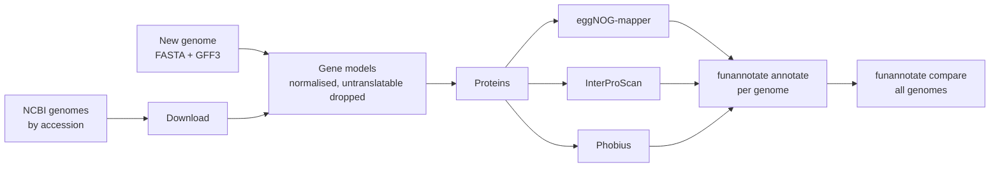

# Comparison

Assembly and annotation of *Porites* sp. Indonesia compared with the annotated NCBI *Porites* genomes and
*Acropora millepora*. Every genome, ours included, is re-annotated with the same functional annotation, so
the comparison is not biased by different annotation pipelines.

## Steps



## How to run

```bash
cd comparison
nextflow run main.nf -params-file params/Porites_sp_v1_2.yaml                          # workstation
nextflow run main.nf -profile binac2 -params-file params/Porites_sp_v1_2_binac2.yaml    # BinAC 2
```

The params file lists the genomes (by path or NCBI accession), the databases and the output folder.
`compare_synteny: false` (the `-nosynt` params file) runs ProteinOrtho without synteny; that run is the one
used in the manuscript.

## Results

```text
results/Porites_sp_v1_2-no-synt/
├── 00_inputs/                       params, downloaded NCBI genomes
├── 01_prepared/<genome>/            gene models
├── 02_proteins/<genome>/
├── 03_functional_annotation/<genome>/
│   └── eggnog/ interproscan/ phobius/ funannotate/
├── 04_compare/funannotate_compare/  report and comparison tables
└── pipeline_info/                   run reports
```

Manuscript figures: `plots/run_all.sh`. Genomes, tool versions and settings, BinAC 2 setup:
[docs/pipeline.md](docs/pipeline.md).
