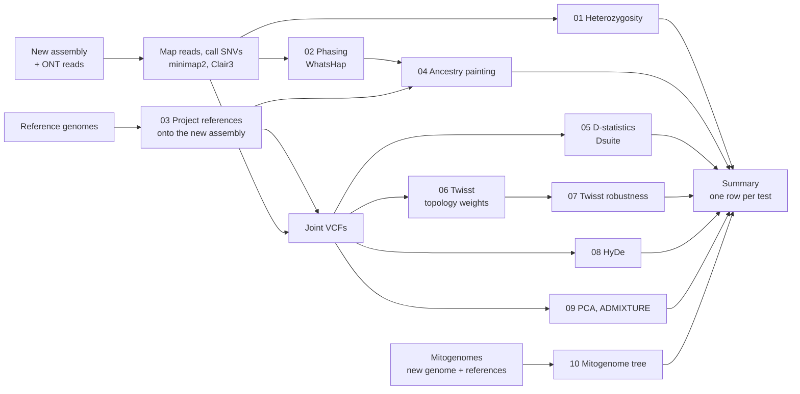

# Introgression

Tests whether *Porites* sp. Indonesia is a hybrid of *P. lobata* and *P. harrisoni*, or carries
introgression from either, with *P. cylindrica*, *P. divaricata* and *P. australiensis* as outgroups.

## Steps



## How to run

```bash
cd introgression
nextflow run main.nf -params-file params/Porites_sp_v1_2.yaml
```

The params file sets the new genome (`name`, `fasta`, `mito`, `agp`), the reads and the output folder;
the reference panel (parents, outgroups, extra genomes) is in `references.tsv`. Most tools run in pinned
BioContainers images; Dsuite, HyDe and Twisst need the custom image, built once:

```bash
cd containers && apptainer build --fakeroot ~/SINGULARITY_CACHE/introgression_tools_1.0.sif introgression_tools.def
```

## Results

```text
results/Porites_sp_v1_2_nf/
├── 00_inputs/                scaffold set, panel and params of the run
├── 01_heterozygosity/        het SNVs, read depth
├── 02_phasing/               phase blocks, phased VCF
├── 03_reference_alignment/   each reference projected onto the new assembly
├── 04_ancestry_painting/     painting of the two haplotypes
├── 05_d_statistics/<og>/     D, f4-ratio per outgroup
├── 06_twisst/                topology weights per outgroup
├── 07_twisst_robustness/     weights over the grid of settings
├── 08_hyde/                  HyDe tests
├── 09_pca_admixture/         PCA and ADMIXTURE
├── 10_mitogenome/            mitogenome tree
├── summary/results.tsv       one row per test
└── pipeline_info/            run reports
```

Manuscript figures: `plots/run_all.sh`. Inputs, panel columns, tool versions and settings:
[docs/pipeline.md](docs/pipeline.md).
