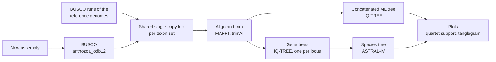

# Species tree

Placement of *Porites* sp. Indonesia among *Porites* from single-copy BUSCO proteins: concatenated
maximum likelihood (IQ-TREE) and coalescent (ASTRAL-IV) trees, each for two taxon sets (`small`: one
genome per species, `large`: all genomes), rooted on *Acropora muricata*.

## Steps



## How to run

```bash
cd species_tree
nextflow run main.nf -params-file params/Porites_sp_v1_2.yaml
```

The params file sets the new genome (`name`, `fasta`) and the output folder (`outdir`); the taxon sets
are in `references.tsv`. Tools run in pinned containers (Apptainer); `-resume` reuses finished tasks.

## Results

```text
results/Porites_sp_v1_2/
├── 00_inputs/          params and taxon sets of the run
├── 01_busco/           BUSCO run of the new genome
├── 02_loci/<set>/      loci shared by all genomes of the set
├── 03_alignments/<set>/
├── 04_concat/<set>/    concatenated ML tree (<set>_concat.treefile)
├── 05_gene_trees/<set>/
├── 06_astral/<set>/    ASTRAL-IV species tree (<set>_astral.tre)
├── 07_plots/<set>/     analysis plots
└── pipeline_info/      run reports
```

Manuscript figures: `plots/run_all.sh`. Tool versions and settings of each step: [docs/pipeline.md](docs/pipeline.md).
